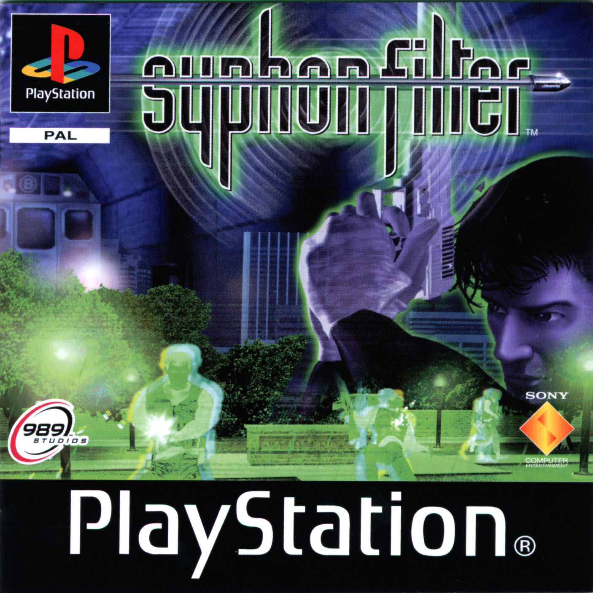

# Syphon Filter — Remake Research and Prototype



*French PlayStation cover, SCES-01911. Source: [PSX Data Center](https://psxdatacenter.com/games/SCES-01911.html).*

This repository contains the first steps toward an unofficial French-language remake of the original PlayStation *Syphon Filter*. Eidetic's original source code has not been found; the community projects referenced below are separate efforts. The 3D remake and its French localization have not yet been completed.

## French PS1 Disc Image

**[Open the French PS1 disc image (BIN and CUE)](game-disc/)** — Syphon Filter, French edition SCES-01911. The BIN contains the disc data (697 MB); the accompanying CUE describes the disc track.

The French SCES-01911 disc image is stored in `game-disc/` as a BIN/CUE pair. The BIN file is tracked with [Git LFS](https://git-lfs.com/) because it exceeds GitHub's regular file size limit. Install Git LFS before cloning; for an existing clone run `git lfs install` and `git lfs pull` to download the image. Keep the BIN next to its CUE file.

Git LFS storage and public downloads count toward the repository owner's quota and may incur charges if the included allowance is exceeded.

## Initial Work on the French Disc

The French PS1 edition, **SCES-01911**, was identified using its `SYSTEM.CNF` file. On this disc image, `/FOG/SUBWAY.FOG` contains `WLDEMD.HOG` and its 91 environment models for the first area. All 91 models were converted locally: 32,323 vertices and 36,021 triangles. The converted geometry is generated on the user's machine and is not included in this repository.

A raw geometry viewer is available at `visualiseur/index.html`: open the page in a browser and choose the generated OBJ files. You can rotate and zoom the scene. **This is not a game yet**: textures, characters, animations, collisions, and gameplay have not been implemented.

The tools `tools/inspecter_disque_ps1.py`, `tools/archives_syphon.py`, and `tools/exporter_emd_obj.cpp` inspect the local disc image, FOG/HOG archives, and EMD geometry. The EMD parser comes from the SF-pc-port project referenced below. To reproduce the export from a local CUE/BIN image, using Python 3 and a C++20 compiler (`clang++` or `c++`):

```sh
mkdir -p work
python3 tools/preparer_geometrie.py "game-disc/Syphon Filter (France).cue" work/geometry
```

The destination directory must not already exist, and its parent must exist. The resulting `work/geometry/georgia-street.obj` and individual OBJ files can be opened in the viewer. The tool does not modify the source image.

Run the tests with:

```sh
python3 -m unittest discover -s tests -v
```

See [docs/french-ps1-research.md](docs/french-ps1-research.md) for details on these initial findings and the REA analysis.

## Recovered PS1 Sources and PC Port

The two projects are referenced as Git submodules at pinned revisions, with their histories and notices preserved in their respective repositories:

- [`references/syphon-filter-xport`](https://github.com/psxports/SyphonFilter-xport): a C decompilation project for the PS1 game. It is experimental; its degree of completion and build process have not been verified. Its code references the US v1.0 release.
- [`references/sf-pc-port`](https://github.com/Madxbio97/SF-pc-port): an unofficial Windows PC port. It uses PS1 game code with a PC runtime and advertises a 20-mission campaign. Playing it requires a BIN/CUE image of **Syphon Filter USA NTSC-U v1.1**, serial number SCUS-94240. The image is not required to compile the project. The port's interface is available in English or Russian.

To clone this repository with both projects:

```sh
git clone --recurse-submodules https://github.com/nicolashedoire/syphon-filter-remake.git
```

If the repository is already cloned:

```sh
git submodule update --init --recursive
```

Consult the respective repositories for the licenses of each project, dependency, and visual asset. A license covering community code does not automatically grant rights to the original game data.

## French Language and Original Release

Sony provides an [official French manual](https://secure.cdn.us.playstation.com/manuals/classic/games/syphon-filter-manual-fr.pdf) identified as SCES-01911. The French PS1 edition provides a reference for the text and atmosphere. Its compatibility with the projects above has not been established: they target different US releases.

Work to investigate includes supporting the French release or translating the port; restoring and validating French menus, briefings, and text; and then improving the visuals and gameplay to build a faithful remake. Voices and cinematics also depend on the game release used.

The [Internet Archive search](https://archive.org/search?query=syphon+filter&tab=all) includes game images, videos, and models. No official development source code was identified in the records examined.

## Independent Prototype

The initial prototype, “Opération Sillage,” remains available: open `index.html` in a recent desktop browser. It is a top-down stealth mission inspired by the genre, not a reproduction of the PS1 game.

- **ZQSD** or **arrow keys**: move; **mouse**: aim and shoot.
- **Shift**: walk stealthily; **E**: interact; **R**: reload.

This is an unofficial project with no affiliation to the rights holders of Syphon Filter.
